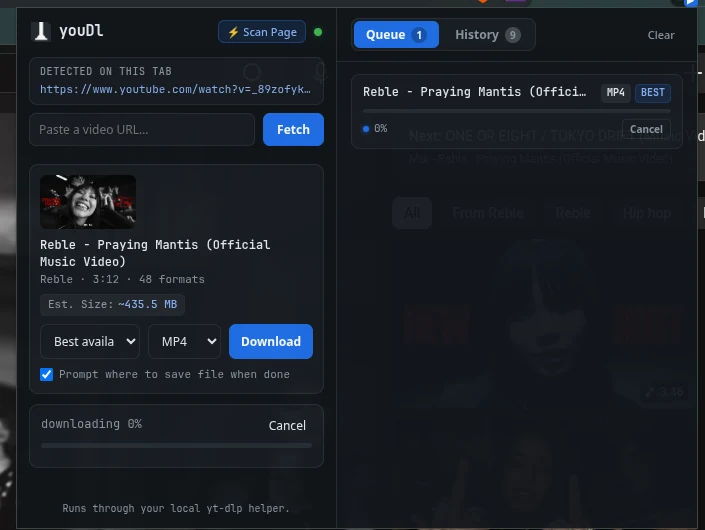

# youDl

youDl is a personal-use browser extension that runs `yt-dlp` on your computer. The extension connects to a local **Native Messaging Host** that the browser launches when needed. Downloads stay on your machine; there is no hosted service, account, or open localhost port.

```
Browser extension ⇄ Native Messaging ⇄ Local youDl host → yt-dlp → your files
```



## Install

### Requirements

- Node.js 18 or newer
- `yt-dlp` available on your PATH
- `ffmpeg` available on your PATH for merging separate audio/video streams and conversion. The installer checks for it and warns if it is missing; it does not install ffmpeg.

### Register the native host

Run the installer once from the project root. It registers the host with Chrome, Brave, Edge, and Firefox on the current computer.

- **Linux / macOS:** `./native-host/install.sh`
- **Windows:** double-click `native-host\\install.bat`

The native host starts automatically when you use the extension; you do not need to keep a server or terminal running.

### Load the extension

- **Chrome / Edge / Brave:** open the browser's extensions page, enable Developer mode, choose **Load unpacked**, and select `extension/`.
- **Firefox:** open `about:debugging#/runtime/this-firefox`, choose **Load Temporary Add-on**, and select `extension/manifest.firefox.json`. Temporary add-ons must be loaded again after Firefox restarts.

Reload the extension after registering the host. If using an unpacked Chromium extension with a different extension ID, pass that ID to `install.sh` (or `install.bat`) so the host allows it.

## Use it

- On YouTube watch, Shorts, and supported thumbnail pages, use the youDl download control.
- Or paste a video URL into the extension popup.
- Choose a quality and format, then download. Progress and cancellation are available in the popup.

Other site support depends on `yt-dlp` and each site's availability. Only save videos you have permission to download.

## How the connection works

The browser launches `native-host/host.js` through Native Messaging. The host uses the local modules in `server/src/` to run `yt-dlp` and report progress over the browser's private standard-input/output channel. It does not expose an HTTP listener or require a server process to be started manually. Download jobs and history are held in memory and are cleared when the host exits.

## Project layout

```
extension/             Browser extension (Chromium and Firefox manifests)
native-host/           Native Messaging host and per-platform installers
server/src/            Shared yt-dlp runner and in-memory job manager
scrollcraft/builds/    Landing page and downloadable personal-use bundle
```

The extension is distributed as an unpacked personal-use tool, not through the Chrome Web Store or Firefox Add-ons marketplace.
